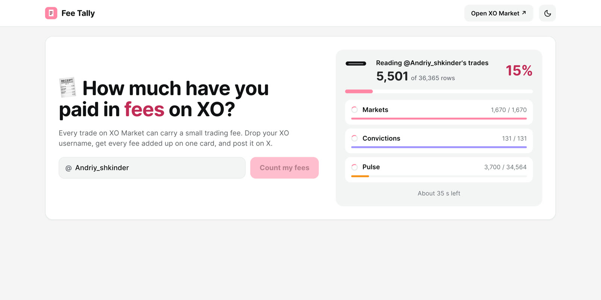
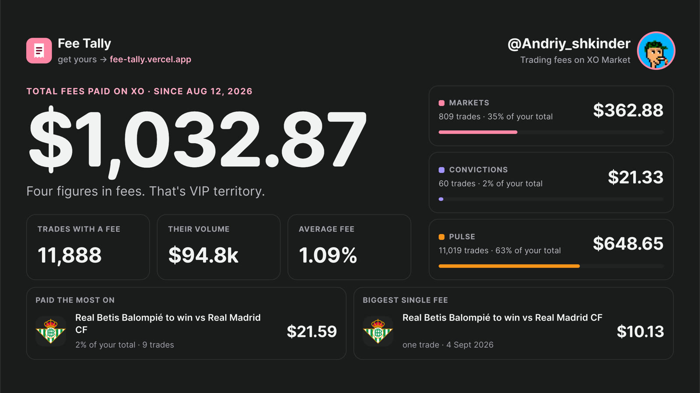
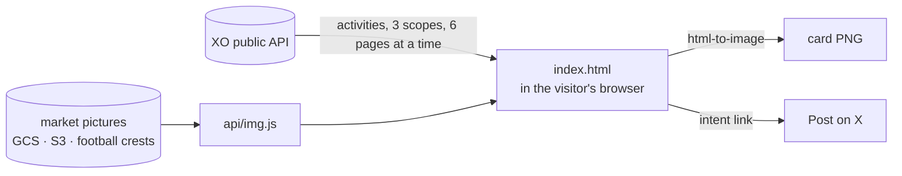

# Fee Tally

**How much have you paid in trading fees on [XO Market](https://beta.xo.market)?**
Drop an XO username and Fee Tally adds up every fee XO recorded on that trader's buys and sells: markets, convictions and Pulse, on one card you can post on X.

**→ [fee-tally.vercel.app](https://fee-tally.vercel.app)**

<p align="center">
  
  
</p>

## Features

- **One card, ready for X**: the total, the trades that carried a fee, their volume and the average fee, a split by Markets, Convictions and Pulse, the market you paid the most on and your biggest single fee, with the market's picture.
- **Download PNG** (2400×1350), **Copy image** to paste straight into a post, and **Post on 𝕏** with a ready text and the site link.
- **Live progress while it reads**: rows read out of the total, a bar per section and a rough time left. Big accounts (tens of thousands of rows) take about half a minute.
- **Clear answers when it can't count**: private profiles, unknown usernames and XO being unreachable each get their own panel instead of an error line.
- Username suggestions with avatars as you type, light and dark themes, phone-friendly, no cookies, no login.

## How it works



- Everything happens **in the visitor's browser**. The page reads `/profiles/<user>/activities` from XO's public API in three scopes (markets, `onlyConviction`, `onlyClobPulse`). Deep pages take about a second each, so after the first page it reads six pages at a time, well under XO's limit of 100 requests per 10 s.
- There is **no database and no indexer**. Nothing about a trader is stored anywhere; the card is built from what XO returns at that moment.
- **The card** is plain HTML at 1200×675, scaled to fit the screen, and turned into a PNG with [html-to-image](https://github.com/bubkoo/html-to-image).
- **Market pictures** come from three hosts that send no CORS headers, so the PNG export can't read them directly. `api/img.js` passes through those three hosts only (and caches them); any other host is refused and the card shows the market's first letter instead.

## What counts

- A **fee** is `tradingFee.feeInUSD` on a buy or sell in the trader's activity. XO records it from **August 12, 2026**; earlier trades have no fee on record and aren't counted.
- Trades with no fee on record count as $0. Most of them look like limit orders that rested on the book. Redeeming shares has no fee.
- **Their volume** is the size of the trades that carried a fee, not all of a trader's volume. **Average fee** is the total fee divided by that volume.
- **Paid the most on** adds up the fees per market. Every five-minute Pulse round is its own market, named by the time of the first trade in it. **Biggest single fee** is the largest fee on one trade.
- Rows that look the same are real separate fills and are all counted: their sum matches XO's own volume to the cent. Only if the trader trades while the page is reading does it drop the rows that slid across a page boundary.
- Private profiles return no activity, so they can't be counted. The page explains how to switch a profile to public for a moment.

## Run it locally

```sh
python3 -m http.server 8792     # http://localhost:8792
```

Nothing to install. `api/img.js` only runs on Vercel, so locally market pictures fall back to the first letter.

## Deploy your own

1. Fork the repo and import it into [Vercel](https://vercel.com) (Framework preset: Other). No settings or env vars are needed.
2. Optional: turn on Vercel Web Analytics (Analytics tab → Enable, then redeploy). The snippet is already in `index.html`.
3. Change `REF` at the top of the page script to your own referral link, and `TWEET_TAGS` to the accounts you want in the post.

## Project layout

| Path | |
|---|---|
| `index.html` | The whole site (static, no build step). |
| `api/img.js` | Allow-listed proxy for market pictures, so the PNG export can inline them. |
| `users.json` | Usernames, avatars and verified flags for the suggestions (shared with XO Wrapper). |
| `og.png` | The link preview image. |
| `fonts/` | Open Runde, the XO app's typeface. |
| `mascot/accountant.webp` | The accountant mascot, switched off for now. |
| `docs/` | Screenshots for this README. |

## XO API notes

- 100 requests per 10 s. `take` goes up to 100; `meta.pageCount` and `meta.itemCount` come with the first page.
- `/profiles/<user>/activities` leaves out Pulse rounds and convictions unless you ask with `marketScope=onlyClobPulse` / `onlyConviction`.
- `/profiles/<user>` has `isPrivate`; a private profile's activity comes back empty. An unknown username is a 404.
- Market pictures live on `storage.googleapis.com/market-image-mainnet`, `market-images-623756711122.s3.eu-west-1.amazonaws.com` and `crests.football-data.org`, none with CORS headers.

---

Built by **Andriy_shkinder** for the XO community, from XO's public data.
